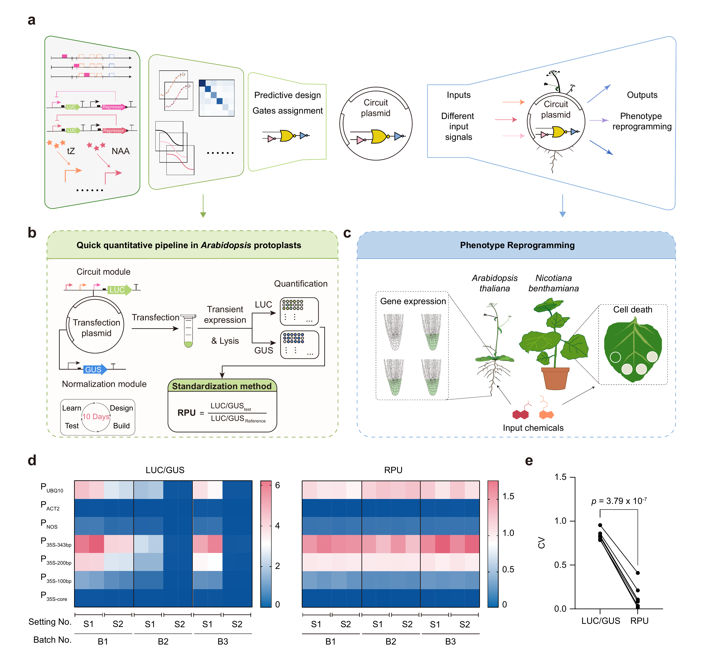
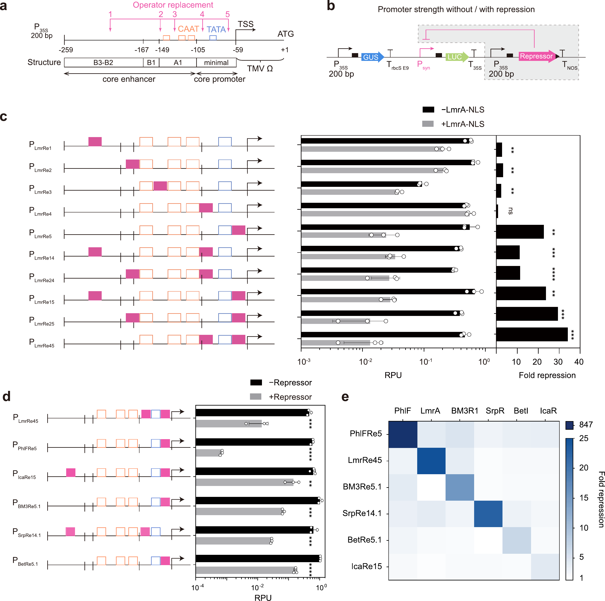
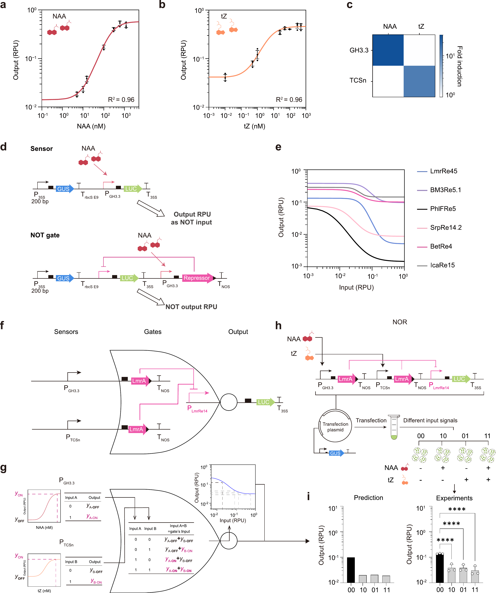
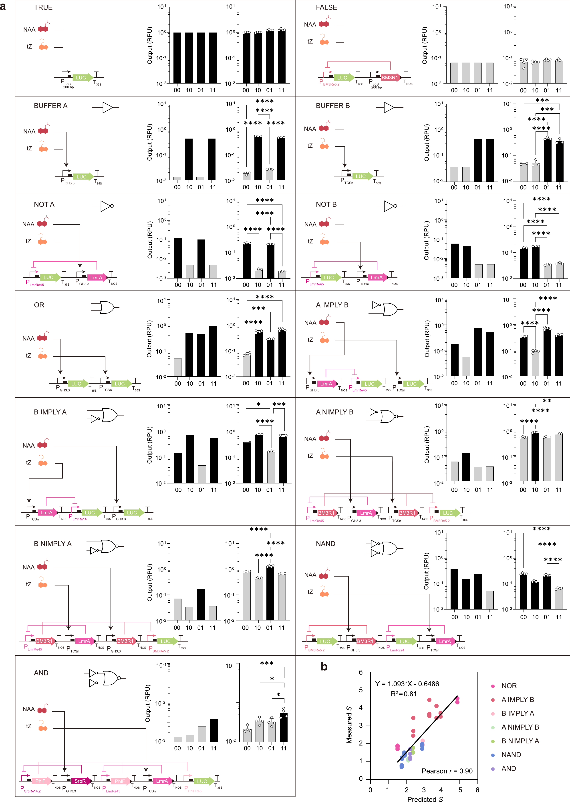
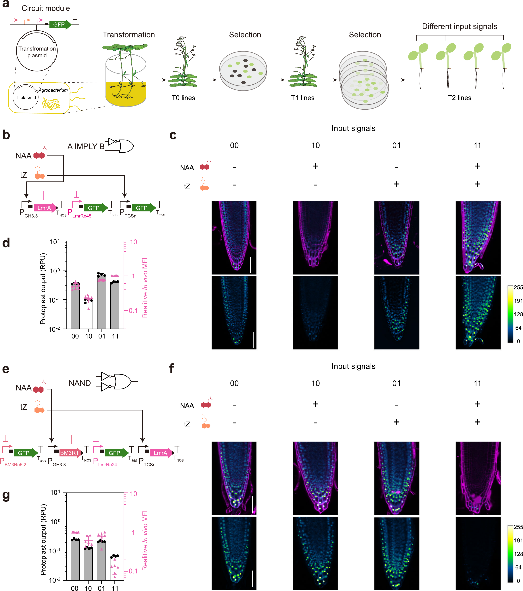
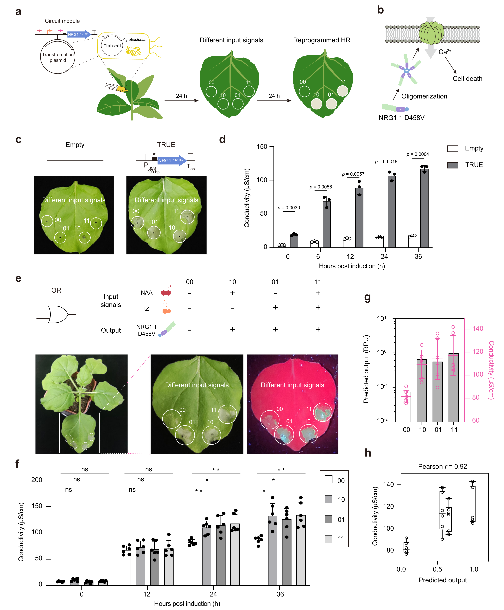

# 给植物装"可预测电路"：十天定量画好设计再动手

## 📋 文章信息

| 字段 | 内容 |
|:---|:---|
| 📌 **标题** | Predictive genetic circuit design for phenotype reprogramming in plants / 植物表型重编程的可预测遗传电路设计 |
| 👥 **作者** | Ci Kong¹,²（孔慈）、Yin Yang³（杨寅）、Tiancong Qi³（戚天聪）＆ Shuyi Zhang¹,⁴,⁵,⁶★（张数一，通讯作者，shuyizhang@tsinghua.edu.cn） |
| 🏛️ **机构** | 清华大学药学院（¹）、北京生命科学研究院（²）、清华大学生命科学学院（³）、分子肿瘤学全国重点实验室·药学院（⁴）、清华大学合成与系统生物学中心（⁵）、北京结构生物学前沿研究中心（⁶） |
| 📍 **出处** | Nature Communications（2025）16:715 · DOI: `10.1038/s41467-025-56042-2` · Received 2024-08-21 / Accepted 2025-01-07 / Published online 2025-01-16 · 开放获取（CC BY 4.0） |
| 🔗 **链接** | [论文全文](https://doi.org/10.1038/s41467-025-56042-2) · 元件序列（ICE 登记表）见 Supplementary Data 1；Source Data 随文在线 · 未提供公共代码仓库 |
| ⭐ **评级** | ⭐⭐⭐⭐（把植物遗传电路从"反复试错、一次定死"变成"可预测、可复用、约10天出结果"，打通从设计到表型的闭环；但仅在拟南芥/本氏烟草与细胞/根尖层面验证，尚未到作物田间） |

---

## 🔍 快速浏览 (Quick Scan)

> ⏱️ **读者导航：** 按需取读，不必从头读到尾——
> - **5–10 分钟速览**：先看 `📋 文章信息`，再读本节的速览、研究总览、核心方法、关键数字速览
> - **15–20 分钟细读**：继续读 `🗺️ 结果叙事`（背景动机 → 结果证据链 → 面板精读 → 局限），抓"这张图证明了什么"
> - **复现 / 深究**：`🔍 面板精读` + `📎 附录`（方法要点、公式、术语、延伸阅读）

> **一句话速览：** 给植物做了一套"先算后做"的电路设计法，让基因开关按需、按量、预知地工作。

---

### 📖 研究总览（本文做了什么）

植物不会动，只能靠一套精巧的分子网络去感知、回应环境。作者想把这套网络"重新接线"，让植物按人的设计去应答特定信号——但要干成这件事，卡在两个老问题：植物长得慢（一代要好几个月），而且缺一套统一、可量化的"元件测量方法"，导致每次都得反复试错。本文的核心思路是把工程学那套"标准化 + 模块化 + 建模"搬进植物：先用统一单位 RPU 把所有元件（启动子、传感器、NOT 门）在原生质体里快速标定（约 10 天就能测完），把性能转成 Hill 方程的参数；再用这些参数，在纸上先"预测"一个双输入逻辑电路该长什么样、输出该是多少，最后按模型去搭，并用荧光或细胞死亡来做验证。结果是用 21 个双输入电路、14 种逻辑证明"预测和实测高度一致"（$R^2=0.81$），并在拟南芥根尖和本氏烟草里实现了多状态表型控制。整篇的价值在于：植物遗传电路第一次做到"能预测、可复用、约 10 天出结果"，而不是"每个状态硬编码一段 DNA、撞运气"。

---

### 💡 核心方法（用一个例子讲清楚）

假设你要造一个"只有同时有生长素（auxin，输入 A）和细胞分裂素（cytokinin，输入 B）时才亮绿灯"的电路：

> 先认三个词：**报告基因**＝能被我们"看见/测量"的指示灯蛋白（本文用会发光的萤火虫荧光素酶 LUC）；**内参**＝一个"不管怎样都稳定表达"的对照蛋白（GUS），用来抵消每个细胞转进多少 DNA 的差异；**原生质体**＝去掉细胞壁的植物单细胞，像"一次性试管"，比等整株植物快得多。

1. **定"尺子"**：往原生质体里塞两个"指示灯+对照灯"，读出各自的亮度，相除得到 LUC/GUS——相除是为了扣除"每个细胞转进 DNA 的量不一样"造成的偏差。再除以一个固定的基准启动子（P35S 200bp）的读数，就得到人人可比的单位 **RPU**。这么一来，不同批次、不同机器的读数才能对齐。
2. **收"零件"并标定**：收集两个传感器（auxin 传感器、cytokinin 传感器）、一批"可被抑制的合成启动子"、一批 NOT 门（输入来了就反转输出）。逐个输入不同浓度的小分子，用 Hill 方程去拟合每个元件的响应曲线，得到"多少输入→多少输出"的参数。
3. **在纸上"预测"**：把传感器输出作为 NOT 门的输入，按电路的拓扑结构（串联就层层传、并联就相加）把参数代进去，算出每个输入组合下最终输出是"亮"还是"灭"。
4. **按图施工 + 验证**：把预测的 DNA 序列搭出来，转进原生质体测一遍；再换成 GFP 转进拟南芥、或接上"细胞死亡开关"转进烟草，看真实结果是否等于预测。
5. **打分**：用一个叫"电路得分 S"的指标（最低的 ON 态 / 最高的 OFF 态）来量化"开和关分得够不够开"，看预测与实测的相关系数。

一句话类比：就像写代码前先建好每个元器件的"规格书"——把每个基因开关放到原生质体这个"测试台"上校准成参数，先在电脑上把电路搭好、跑一遍仿真，再把整套程序一次性"烧录"进整株植物这台上线后很难返工的"真机"——而不是直接在不耐折腾的植株上反复试错。

#### 🔑 关键设计选择 1：RPU 归一化当"统一标尺"

- **直观理解：** 让不同批次、不同仪器测出来的基因表达数据能放在同一张表里比较。
- **做法：** 用 LUC/GUS 双报告校正细胞间差异，再除以一个固定基准启动子（P35S 200bp）的 LUC/GUS，得到无量纲的 RPU。
- **为什么关键：** 没有统一单位，元件参数根本无法跨批次复用；这是"可预测"的地基。

#### 🔑 关键设计选择 2：用原生质体做"快速测量台"

- **直观理解：** 在单细胞（原生质体）里快速、可重复地测元件，避免每次都等整株植物。
- **做法：** 建立原生质体瞬时表达体系，约 10 天标定一批元件，并用 RPU 表征。
- **为什么关键：** 大幅缩短"测量→反馈"的循环，是"约 10 天"能成立的关键。

#### 🔑 关键设计选择 3：Hill 方程参数化 + 模块化叠加建模

- **直观理解：** 把每个元件都抽象成"输入→输出曲线"，用参数（最小/最大输出、Hill 系数 n、半最大值浓度 K）描述，再按电路结构把参数串/并起来。
- **做法：** 传感器测输入-输出曲线，NOT 门拟合 Hill 方程；串联层层传、并联直接相加，预测整个电路的输出。
- **为什么关键：** 这是"先算后做"的核心——不是靠经验猜，而是靠可复算的参数算出来。

---

#### 📌 关键数字速览（一屏看懂结果）

- **可重复性：** RPU 把不同批次/批次间的变异显著压低——LUC/GUS 与 RPU 的变异系数（CV）差异 p = $3.79\times10^{-7}$（Student t 检验，成对、双尾）。
- **元件性能：** 合成启动子被抑制的倍数从 4.3（IcaR）到 847（PhlF）；auxin 传感器 fold induction 40、Hill 系数 $$n=1.32$$；cytokinin 传感器 fold induction 12、$$n=0.8$$；两传感器拟合 $R^2=0.96$；多数 NOT 门的 Hill 系数 $$n>2$$。
- **预测能力：** 21 个双输入电路实现 14 种逻辑；预测与实测的电路得分 S 高度相关——Pearson $r=0.90$、$R^2=0.81$（Fig. 4b）。
- **体内验证：** 拟南芥根尖 A IMPLY B（3 个 T2 系）与 NAND（4 个 T2 系）逻辑与原生质体一致；本氏烟草 OR 门控制细胞死亡，预测输出与 24 h 电导率（细胞死亡）Pearson $r=0.92$。

> 🔎 想看验证细节的读者，跳到对应 `📊 结果` 小节。

---

## 🗺️ 结果叙事 · 按图组织 (Results Narrative)

> Sci/Nature 的 Results 是按图组织的证据链，而非"方法 → 实验"两段式：**一张图回答一个递进的问题**。常见节奏：Fig. 1 总体框架 → 中间图逐一验证方法各环节 → 最后一两张给出应用。

### 🧩 背景 & 动机

植物遗传电路长期"长周期 + 难重复 + 不可预测"：转基因要 >2 个月一代，量化手段缺失，可复用元件稀缺，且已有电路多为"一个状态写死一段 DNA"，换状态就得换序列。本文从"标准化测量 + 模块化元件 + 数学建模"切入，目标是在植物里实现像细菌/酵母那样"预测先行"的设计。

### 🗺️ 结果证据链 · 泛读版

> 面向"只想快速 get 逻辑"的读者。按论文叙事顺序，每个有叙事价值的 Figure 必写一小节；每节只含四要素，不含面板级细节（面板级证据在下一节 `🔍 面板精读`）。

#### 📊 结果 1 · 一套"测量+设计+应用"的总框架（Fig. 1）

- **该图回答的问题：** 这套框架长什么样，以及它能否把"元件测量"做到可重复、可量化？

- **🗺️ 读图路径：**
  > 面板 a 给出总体框架：预测设计 → LUC 元件 → 不同输入信号 → 输出 → 表型重编程 → 再反馈设计；面板 b 拆出"快速可重复的量化方法"：原生质体 + 双报告 LUC/GUS + RPU；面板 c 落到应用：把电路接进拟南芥/烟草做表型控制；面板 d–e 用实际数据证明 RPU 能把批次与仪器差异压下去（CV 显著下降）。
- **关键证据：** 7 个组成型启动子在 3 个原生质体批次、2 个增益设置下测量，LUC/GUS 与 RPU 的 CV 差异 p=$3.79\times10^{-7}$（t 检验，双尾、成对）。
- **结论：** 这套框架提供了"约 10 天、可重复、可量化"的元件测量基础，是可预测设计的根基。

#### 📊 结果 2 · 造出可被"开关"的合成启动子（Fig. 2）

- **该图回答的问题：** 能否用抑制因子（repressor）把启动子做成"能被关掉"的模块？

- **🗺️ 读图路径：**
  > 面板 a 基于 200 bp 的 35S 启动子标出 5 个可替换"操纵子位点"；面板 b 给出筛选用的质粒设计；面板 c 用 LmrA 抑制因子筛选插入位点；面板 d 扩大到 6 个 TetR 家族的抑制因子，比较抑制后强度；面板 e 检验正交性（互不串扰）。
- **关键证据：** 抑制倍数从 4.3（IcaR）到 847（PhlF）；置入 CAAT 盒与 TSS 之间效果最好；BM3R1 与 PhlF 之间串扰最小。
- **结论：** 得到一批正交、可调、可被抑制的合成启动子，作为电路的"模块化开关"。

#### 📊 结果 3 · 定量标定传感器与 NOT 门，并预测 NOR 门（Fig. 3）

- **该图回答的问题：** 关键元件的输入-输出参数能否被精确测出，并据此预测一个"或非门"？

- **🗺️ 读图路径：**
  > 面板 a–b 分别拟合 auxin（NAA）与 cytokinin（tZ）传感器的 Hill 响应；面板 c 验证二者正交、互不串扰；面板 d 把传感器输出作为 NOT 门输入进行参数化；面板 e 比较 6 种 NOT 门的输入-输出曲线；面板 f–g 用"两个传感器并行 + 一个合成启动子"模块化预测 NOR 门；面板 i 给出预测与实测对比。
- **关键证据：** auxin 传感器 fold induction 40、$$n=1.32$$；cytokinin 传感器 fold induction 12、$$n=0.8$$；两传感器拟合 $R^2=0.96$；多数 NOT 门 Hill 系数 $$n>2$$；NOR 门预测与实测在 4 种输入组合下高度一致（****p<$10^{-4}$）。
- **结论：** 元件可精确参数化，且模块化建模能准确预测一个双输入的 NOR 门。

#### 📊 结果 4 · 预测 21 个双输入电路的性能（Fig. 4）

- **该图回答的问题：** 建模能否泛化到大量、多样的双输入逻辑电路？

- **🗺️ 读图路径：**
  > 面板 a 逐电路对比"设计/预测"与"实测"表现（含 TRUE、FALSE、OR、A IMPLY B、NIMPLY、NAND、AND、BUFFER、NOT、B IMPLY A 等，共 13 个在图内展示），黑/灰柱分别对应期望 ON/OFF；面板 b 把每个电路的"电路得分 S"预测值对实测值画成散点。
- **关键证据：** 预测与实测的 S 高度相关（Pearson $r=0.90$、$R^2=0.81$）；较复杂多层电路（如 NIMPLY、AND）RPU 有轻微偏差，源于资源竞争、蛋白周转与模型简化。
- **结论：** 该建模框架能跨电路、跨逻辑泛化预测，是"可预测设计"的直接证据。

#### 📊 结果 5 · 体内：拟南芥根尖重现逻辑（Fig. 5）

- **该图回答的问题：** 在完整活体植物里，设计的电路是否仍按预测工作？

- **🗺️ 读图路径：**
  > 面板 a 示意把 LUC 换成 NLS-GFP 并转入稳定转基因系；面板 b、e 给出 A IMPLY B 与 NAND 的电路结构；面板 c、f 是不同输入组合下根尖的共聚焦荧光图（绿-蓝伪彩，标尺 50 μm）；面板 d、g 把根尖相对 GFP 强度与原生质体的预测输出叠在一起。
- **关键证据：** 在拟南芥根尖（柱细胞、静止中心、侧根冠）观察 A IMPLY B（3 个 T2 系）与 NAND（4 个 T2 系）逻辑；体内相对 GFP 强度与原生质体/预测输出一致。
- **结论：** 电路在完整植物体内按预期工作，体内-体外一致性良好。

#### 📊 结果 6 · 用电路程序化控制烟草细胞死亡（Fig. 6）

- **该图回答的问题：** 能否用逻辑电路在植物里"按需"触发细胞死亡（一种可观察的表型）？

- **🗺️ 读图路径：**
  > 面板 a 示意烟草叶片经农杆菌浸润 + 24 h 后加诱导剂、再 24 h 测电导率（细胞死亡读数）；面板 b 用 NRG1.1^D458V 自激活寡聚 + Ca²⁺ 内流解释死亡机制；面板 c、e 分别用 TRUE 门与 OR 门在 4 态（00/10/01/11）下触发死亡；面板 d、f 用电导率定量；面板 g、h 叠上模型预测并算相关性。
- **关键证据：** OR 门在 4 个输入态下控制细胞死亡，预测输出与 24 h 电导率 Pearson $r=0.92$（6 个生物学重复，two-way ANOVA + Dunnett's）。输入态由"是否加 NAA（1 μM）"和"是否加 tZ（1 μM）"决定。
- **结论：** 可预测设计的电路能在活体植物里控制死亡这种"宏观表型"，且与模型预测高度吻合。

### 🔍 面板精读 · 核心证据（Fig. 3、Fig. 4、Fig. 6）

> 三个小节分别支撑本文三条核心主张：元件可参数化（Fig. 3）、建模可预测（Fig. 4）、可控制可观察表型（Fig. 6）。先整图、再逐个关键面板展开。

#### 🔎 Fig. 3 · 元件标定与 NOR 门预测（支撑主张：元件可参数化 + 模块化建模）

**整图读图顺序：** a–b 建立两传感器的输入-输出曲线 → c 验证正交性 → d–e 把传感器输出作为 NOT 门输入并拟合 → f–g 模块化预测 NOR 门 → i 用实验验证预测。

**面板 a · auxin 传感器：** 横轴为生长素类似物 NAA 浓度（0–1200 nM，0 未展示），纵轴为 RPU 响应，拟合 Hill 曲线，fold induction 40、$$n=1.32$$、$R^2=0.96$，说明该传感器对 auxin 有陡峭、可量化的响应。

**面板 b · cytokinin 传感器：** tZ 浓度 0–500 nM，动态范围较小（OFF 态 0 nM 更高、ON 态 300 nM 更低），fold induction 12、$$n=0.8$$、$R^2=0.96$。

**面板 c · 传感器正交性：** 用 1200 nM NAA 与 300 nM tZ 分别计算 fold induction，证明 NAA 只激发 auxin 传感器、tZ 只激发 cytokinin 传感器，二者互不串扰。

> **先解释两个词：**“传感器”不是电子元件，而是一段天然启动子——例如 auxin 传感器就是 GH3.3 基因的启动子，它能感知小分子浓度并驱动下游基因表达。标定方法正如你猜的：给细胞施加一串浓度梯度的刺激（NAA 从 0 到 1200 nM），测每个浓度下的输出（RPU），用 Hill 方程拟合出这条“输入→输出”曲线。“NOT 门”也不是真实电路，只是一个“抑制因子 + 被抑制的启动子”的基因模块：输入蛋白一来→抑制因子表达→目标启动子被关掉（输出反转），相当于逻辑上的“非”。

**面板 d · 参数化流程：从“正向”传感器到“负向”NOT 门。** 这张图展示了如何把植物对 NAA（生长素类似物）的响应，从“正向调控（Sensor）”转换为“负向调控（NOT gate）”。

**① 上图：Sensor（传感器）**——作用是把 NAA（生长素类似物）浓度转换成可测量的基因表达信号。NAA 激活启动子 $P_{\mathrm{GH3.3}}$，促进下游报告基因 LUC 表达，并通过 GUS 内参归一化为 RPU：$\mathrm{NAA}\uparrow \Rightarrow P_{\mathrm{GH3.3}}\uparrow \Rightarrow \mathrm{LUC}\uparrow \Rightarrow \mathrm{RPU}\uparrow$。即“NAA 越多、输出越强”，相当于一个**正向信号编码器**。

**② 下图：NOT gate（非门）**——作用是把传感器的信号反转。作者通过重新组装 DNA，将 $P_{\mathrm{GH3.3}}$ 的下游基因从 LUC 替换为 Repressor（转录抑制蛋白），同时让 LUC 由另一个可被抑制的合成启动子控制。因此，NAA 越多，Repressor 表达越强，LUC 反而受到更强抑制：$\mathrm{NAA}\uparrow \Rightarrow \mathrm{Repressor}\uparrow \Rightarrow \mathrm{LUC}\downarrow$。即“输入越高、输出越低”（$\mathrm{RPU}_{\mathrm{in}}\uparrow \Rightarrow \mathrm{RPU}_{\mathrm{out}}\downarrow$），相当于神经网络中的一个**非线性反向映射模块**。上下两图是分别构建的 DNA 电路，并非启动子在细胞内发生移动。

**面板 e · NOT 门库：** 六种 NOT 门（LmrA、BM3R1、PhlF、SrpR、BetI、IcaR 组）各自拟合出不同的输入-输出曲线；多数 Hill 系数 $$n>2$$，意味着输入信号能被"陡峭放大"，利于多层电路信号传播。

**面板 f · NOR 门模块化设计：** 生长素与细胞分裂素两个传感器各驱动一份抑制因子（“并联”），共同抑制同一个合成启动子 PLmrRe14；任一传感器被激活都会关掉输出，这正是“或非”（NOR）的逻辑结构。

**面板 g · NOR 门预测建模：** 两传感器为“并联”，RPU 值直接相加得到联合输入；再代入 LmrRe14 NOT 门的 Hill 参数求输出，即可预测四个输入组合（00/10/01/11）的目标输出。

**面板 i · 预测 vs 实测：** 把四个输入组合（00/10/01/11）的预测输出与实验结果并排比较，二者高度一致（****$p<10^{-4}$，One-way ANOVA + Tukey），说明“先计算、后施工”的 NOR 门真的能按设计工作，为后面大规模双输入电路预测打底。

#### 🔎 Fig. 4 · 预测与实测的相关性（支撑主张：建模可预测、可泛化）

**整图读图顺序：** a 逐电路对比预测/实测柱状图 → b 把所有电路的"电路得分 S"预测对实测画散点并求相关性。

**面板 a · 13 个双输入电路：** 对每个电路，左侧预测、右侧实测，黑/灰柱对应预期 ON/OFF；多数电路预测与实测高度吻合，多层电路（NIMPLY、AND）有轻度偏差。

**面板 b · 相关性散点：** 每个点代表一个电路"预测 S vs 实测 S"，横纵一致，Pearson $r=0.90$、$R^2=0.81$，是"预测先行"的核心量化证据。

#### 🔎 Fig. 6 · 程序化控制细胞死亡（支撑主张：可控制可观察表型）

**整图读图顺序：** a 实验流程 → b 死亡机制 → c/d 用 TRUE 门验证“想死就能死” → e/f 用 OR 门证明“按输入组合死” → g 叠上模型预测 → h 求预测与表型的相关性。

**面板 a · 实验流程：** 把同样的电路经农杆菌浸润转进烟草叶片，24 h 后浸润诱导剂（NAA 1 μM / tZ 1 μM 的有无组合），再过 24 h 测叶片电导率——细胞死亡后电解质外漏，电导率升高，所以电导率就是“死亡程度”的读数。图顶部标注了 4 个输入态（00/10/01/11）。

**面板 b · 死亡机制：** 电路输出接到一个“自激活”的免疫受体突变体 NRG1.1^D458V：它一旦表达就会自我寡聚并引发 Ca²⁺ 内流，触发植物超敏反应（HR）细胞死亡——这样“电路输出=1”就直接变成“细胞死亡”。

**面板 c · TRUE 门触发死亡：** TRUE 门=输出恒为开，无论输入如何都会触发细胞死亡；对比空载体（Empty）对照，说明由电路驱动的死亡是特异的，不是浸润操作本身造成的。

**面板 d · TRUE 门死亡定量：** 11 个状态×多个时间点用电导率定量，3 个独立实验，确认“电路开→细胞真死”。

**面板 e · OR 门四态触发：** 只加 NAA（10）、只加 tZ（01）、两者都加（11）都会触发细胞死亡，只有都不加（00）不触发——这正是 OR 门的定义。

**面板 f · 电导率定量：** 四个状态在多个时间点的电解质泄漏（电导率）测出死亡程度，6 个生物学重复，**$p<10^{-2}$、*$p<0.05$、ns（不显著）——只有 00 态显著不同，10/01/11 三态都明显死亡。

**面板 g · 预测叠加：** 把 OR 电路各状态的模型预测（柱状图）与 24 h 实测电导率（粉色数据点）叠在同一张图上，预测的“高/低”与死亡程度一一对应，说明从基因电路到宏观表型都能被模型算出来。

**面板 h · 预测 vs 表型：** 把 OR 门 24 h 的输出与电导率做相关，Pearson $r=0.92$，说明"预测的输出"能很好地对应"实际死亡程度"。

### ⚠️ 局限 & 未来方向

> Sci/Nature 没有独立的 Limitations 节。以下主要来自 Discussion 的谨慎措辞与论文的实际验证边界；推断内容标注"（我的推断）"。

1. **局限 1：** 模型过于简化，忽略了**细胞资源竞争**与**蛋白周转动力学**——在更复杂的多层电路中，这可能导致信号衰减或误差累积（作者在 Discussion 明确承认）。
2. **局限 2：** 验证集中在拟南芥（根尖/原生质体）与本氏烟草（叶片瞬时浸润），未做作物（如水稻、玉米）或田间环境验证（我的推断，作者未提供此类数据）。
3. **未来方向：** 作者提出引入蛋白降解标签、对元件做多维表征，并把**机制模型与机器学习模型结合**；同时开发能感知更多信号（如昼夜节律、低氧、光照）的新传感器，用于花期调控、种子萌发、胁迫耐受与抗病等真应用。

---

## 💬 我的思考

- **启发：** 用"统一单位 + 模块元件参数化 + 数学建模"把植物遗传电路从"反复试错"变成"先算后做"，这套思路几乎可以平移到其他难工程化的系统——关键是先解决"可复用的量化手段"这个地基问题。具体到哺乳动物/类器官，可以照搬本文三步：① 找一组正交的哺乳动物传感器（如激素、小分子感应启动子）并建立对应 RPU 的归一化读数（哺乳动物常用的双荧光素酶 Renilla/Firefly 就与 LUC/GUS 同构）；② 把 TetR 家族抑制因子这类在细菌/哺乳动物里已有正交性数据（论文引文 26 就是哺乳动物中的相关工作）的 NOT 门模块，在目标细胞系里重新标定一遍；③ 沿用 Hill 参数化建模，只是把"原生质体快速测量台"换成高通量单细胞读数（如流式/单细胞转录组），类器官里还要叠加空间读出才能刻画组织内梯度——这三步里最难的是第二步的标定通量，也是植物这篇最值得借鉴的"约 10 天测量台"设计。
- **想验证的点：** 论文用"串联层层传、并联相加"这种极简规则做建模，对于≥3 层的多层电路误差会累积到多大？能否用一个更复杂（如三层 NOR/NAND 组合）的电路，专门检验"资源竞争"和"蛋白周转"这两个被忽略因素的贡献？
- **怎么搬到哺乳动物 / 类器官：** 这套"统一单位 + 元件参数化 + 先用计算预测再动手"的路线，本质是**给系统先建一套可复用的量化标尺**。搬到哺乳动物/类器官，关键是先找到能"标准化读数"的锚点（类似本文的 LUC/GUS + RPU），再为哺乳动物的输入信号（如激素、小分子、光照、细胞因子）搭建正交感器，并让传感器输出直接作为下游 NOT 门的输入（像本文用同一批原生质体把传感器与 NOT 门参数钉在一起）。若能再做一套可预测的"细胞死亡/增殖/分化"等宏观表型读数（本文用电导率测细胞死亡），就能把"算出来的电路"落到可见的生理结果上——这正是本文 Fig. 5/6 演示的"从预测到表型"的移植模板。
- **值得 follow-up 的方向：** 把"降解标签"加进元件库后再标定一轮，看能否系统性压低多层电路误差；或把机制模型与一个轻量机器学习校正器结合，让预测在复杂电路上更准。

---

## 📎 附录

### 🔬 方法要点（源自正文 / Methods / Supplementary）

**问题建模（正文）**

文中未给单个"损失函数"，方法是把每个元件的输入-输出关系参数化后按电路拓扑叠加；并用"电路得分 S"评价预测质量（正文 Results）：

$$
S = \frac{\min(\text{ON 态输出})}{\max(\text{OFF 态输出})}
$$

其中 $S$ 是电路得分，定义为电路输出的最低 ON 态与最高 OFF 态之比；$S$ 越大意味着"开"与"关"分得越开、电路越可靠。

**双报告与 RPU 定义（Methods，式 1–2）**

LUC/GUS 先扣除本底：

$$
\text{LUC/GUS} = \frac{\text{LUC}_{\text{test}}-\text{LUC}_{0}}{\text{GUS}_{\text{test}}-\text{GUS}_{0}} \ (\text{a.u.})
$$

其中 $\text{LUC}_{\text{test}}$、$\text{GUS}_{\text{test}}$ 为测得的荧光素酶发光与 GUS 荧光；$\text{LUC}_0$、$\text{GUS}_0$ 为对应本底值。再归一化到基准启动子：

$$
\text{RPU} = \frac{(\text{LUC/GUS})_{\text{test}}}{(\text{LUC/GUS})_{P35S\,200bp}}
$$

其中 $P35S\,200bp$ 是被用作参考的组成型启动子；RPU 是相对启动子单位，用于跨批次/跨仪器比较。

**Fold repression / induction（Methods，式 3–4）**

$$
\text{Fold change} = \frac{\text{Mean RPU}_{\text{unrepressed}}}{\text{Mean RPU}_{\text{repressed}}}
$$

$$
\text{Fold change} = \frac{\text{Mean RPU}_{\text{induced}}}{\text{Mean RPU}_{\text{uninduced}}}
$$

前者为抑制倍数，后者为诱导倍数；每组均来自 $n\ge3$ 次独立实验的均值。

**Hill 响应函数（Methods，式 5）**

$$
f(x) = y_{\min} + (y_{\max}-y_{\min})\frac{x^n}{K^n+x^n}
$$

其中 $f(x)$ 为门的输出，$y_{\min}$、$y_{\max}$ 为输出最小值与最大值，$n$ 为 Hill 系数，$K$ 为半最大输出对应的输入阈值。

**变异系数（Methods，式 6）**

$$
\text{CV} = \frac{\sigma}{\mu}
$$

其中 $\sigma$ 为标准差，$\mu$ 为均值，CV 用于衡量 LUC/GUS 与 RPU 的可重复性。

**架构与关键实现**

- **测量体系：** 原生质体瞬时表达，双报告 LUC + GUS；同一批次内用 RPU 统一比较。
- **元件库：** 依据 200 bp 35S 启动子替换操作子位点的合成启动子 + 6 个 TetR 家族抑制因子；auxin 传感器用 GH3.3（At2g23170）300 bp 启动子；cytokinin 传感器用 TCSn。
- **建模：** 传感器输出作为 NOT 门输入；串联层间传递 RPU，并联输入直接相加；用 Hill 参数计算最终输出。
- **体内验证：** 把 LUC 换成 NLS-GFP 转入稳定转基因拟南芥；把电路接上"细胞死亡开关"（NRG1.1^D458V 自激活 + Ca²⁺ 内流）在本氏烟草叶片瞬时表达，用电导率测死亡。

**训练/实验配置**

| 项目 | 说明 | 来源 |
|:---|:---|:---|
| **植物材料** | 拟南芥（Col-0）原生质体与植株、本氏烟草叶片 | Methods |
| **克隆** | Golden Gate + Gibson（Vazyme C115）；DH5α 转化；Sanger 测序验证 | Methods |
| **诱导剂** | NAA（auxin）与 tZ（cytokinin），浓度见 Supplementary Table 4 | Methods |
| **测量** | 萤光素酶与 GUS 用 BioTek Synergy H1；GUS 激发 365 nm/发射 455 nm | Methods |
| **统计** | Student's t（双尾）、one-way ANOVA + Tukey、two-way ANOVA + Dunnett's；显著性 ****p<$10^{-4}$、***p<$10^{-3}$、**p<$10^{-2}$、*p<0.05 | Methods/图注 |
| **评分** | 电路得分 S = min(ON)/max(OFF)；预测-实测用 Pearson r、R² | Results |

### 📦 数据与代码可用性

本文未提供独立代码仓库（GitHub 等）。元件序列（各 part ID 对应的 Inventory of Composable Elements，ICE 登记）见 Supplementary Data 1，ICE 可访问 https://registry.jgi.doe.gov/；模块化克隆的详细序列见 Supplementary Data 2–7。主要结果图均提供 Source Data 文件并随论文在线发布（https://doi.org/10.1038/s41467-025-56042-2）。文章以 CC BY 4.0 开放获取，允许翻译与再分发（注明出处即可）。复现门槛：主要需可获取拟南芥/烟草材料与合成生物学质粒构建能力，算力需求低（无模型训练），但需要较扎实的植物转化与原生质体操作经验。

### 📖 术语表

| 术语 | 全称 | 一句话解释 |
|:---|:---|:---|
| 遗传电路 | genetic circuit | 把基因/蛋白质按逻辑关系连起来，让细胞按输入信号决定输出 |
| 合成启动子 | synthetic promoter | 人工设计、可被特定抑制因子"关掉"的启动子 |
| 抑制因子 | repressor | 结合到 DNA 特定位点、阻止基因转录的蛋白 |
| 传感器 | sensor | 能把某小分子浓度转成基因表达强度的元件 |
| NOT 门 / NOR 门 | NOT / NOR gate | 逻辑门：NOT 输入就反转输出；NOR 是"或非" |
| RPU | Relative Promoter Unit | 相对启动子单位，用基准启动子归一化后的表达单位 |
| Hill 方程 | Hill equation | 用最小/最大输出、Hill 系数、半最大阈值描述"输入→输出"曲线的数学函数 |
| 原生质体 | protoplast | 去掉细胞壁的植物细胞，便于瞬时转染与快速测量 |
| 电路得分 S | circuit score | 最低 ON 态 / 最高 OFF 态，衡量"开和关分得够不够开" |
| 正交性 | orthogonality | 各元件只认自己的对象，互不干扰 |
| 表型重编程 | phenotype reprogramming | 让植物按设计改变性状/行为 |
| 农杆菌浸润 | agroinfiltration | 用农杆菌把目标基因导入植物叶片的瞬时表达方法 |

### 📚 延伸阅读

| 论文 | 关联 |
|:---|:---|
| [Kong et al., Nat. Commun. (2025)](https://doi.org/10.1038/s41467-025-56042-2) | 本文（读的我就是这篇） |
| Schaumberg et al., Nat. Methods 13 (2016) | 植物合成生物学元件的定量表征，本文量化的前人基础 |
| Sarrion-Perdigones et al., GoldenBraid 2.0, Plant Physiol. (2013) | 植物 DNA 模块化组装框架，本文克隆的基石 |
| 植物合成生物学综述（如 Nemhauser & Torii） | 补充视角：把工程方法接入植物生物学 |
