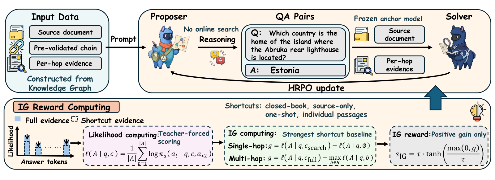
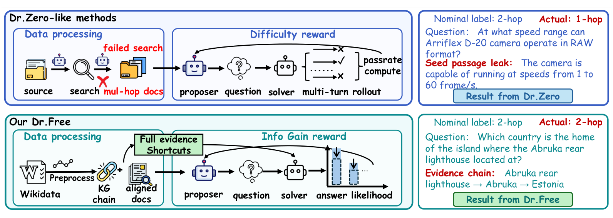
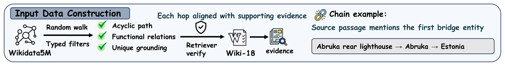
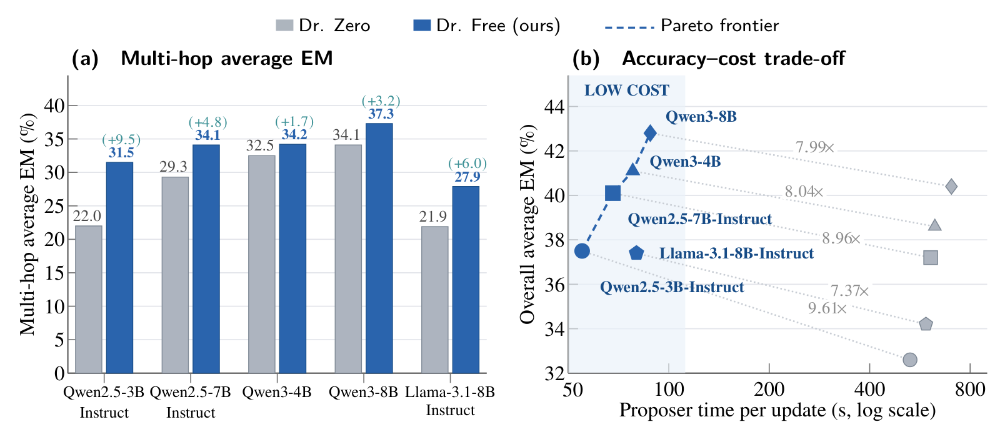

# 📄 Dr. Free: You Don't Need Difficulty Rewards for Self-Evolving Search Agents

## 📋 文章信息

| 字段 | 内容 |
|:---|:---|
| 📌 **标题** | Dr. Free: You Don't Need Difficulty Rewards for Self-Evolving Search Agents |
| 👥 **作者** | Zhipeng Qian、Zihan Liang、Xinyu Sun、Tong Zhao、Yufei Ma、Jie Ma、Ben Chen、Huangyu Dai、Lingtao Mao、Xuxin Zhang、Qingpeng Cai、Peng Jiang、Qibin Hou ★（通讯作者） |
| 🏛️ **机构** | VCIP，南开大学计算机科学学院；快手科技；厦门大学 |
| 📍 **出处** | arXiv:2609.33565v1 [cs.AI]，2026-09-27（arXiv 首版公开日期） |
| 🔗 **链接** | [arXiv](https://arxiv.org/abs/2609.33565)（论文中未给出代码或项目主页链接） |
| ⭐ **评级** | ⭐⭐⭐⭐ |

---

## 🔍 快速浏览

> ⏱️ **读者导航：** 按需取读，不必从头读到尾——
> - **5–10 分钟速览**：先看 `📋 文章信息`，再读本节的速览、研究总览、核心方法（用一个例子讲清楚）、关键数字速览
> - **15–20 分钟细读**：继续读 `🔬 技术深潜`（背景 → 问题建模 → 创新点 → 实验 → 局限）
> - **复现 / 深究**：`🔧 方法细节 · 🔑 核心创新点` + `📎 附录`（公式、术语、延伸阅读）

> **一句话速览：** 用「完整证据 vs 最强捷径」的答案似然差替代通过率当奖励，一次性把出题者从"猜中答案"逼回"必须跨段落拼证据"，且 proposer 训练快 7 倍以上。

---

### 📖 研究总览（本文做了什么）

无数据自演化搜索 agent 通常靠 proposer–solver 自博弈训练：proposer 出题、solver 答题，再用 solver 的 **通过率（difficulty reward）** 反过来奖励 proposer。但作者指出这条因果链是断的—— **通过率只能衡量"当前 solver 会不会答"，却无法说明"这道题是否真的需要跨段落找证据"**。一旦模型靠单段答案或推理捷径蒙对，一个本该多跳的难题就会因为信息捷径而变得简单。作者复现 Dr. Zero 时证实了这一点：两个 backbone 上超过 84%（3B 达 99.995%）标注为多跳的题目根本没发起搜索，答案就写在种子段落里。于是 Dr. Free 从"题目来源"和"奖励信号"两端同时修：**题目端** 直接从 Wikidata5M 采样 **关系链（relational chain）** 并对齐 Wikipedia 段落，把多跳证据结构喂给出题者，出题不再需要在线搜索；**奖励端** 改用 **shortcut-aware information-gain reward**，用冻结的 anchor 模型比较"完整证据"与"各种捷径"下的答案似然，只有完整证据确实胜过所有捷径才给正分。结果在 7 个 open-domain QA benchmark、5 个 backbone 上，Dr. Free 平均 EM 超过 Dr. Zero 与监督基线，多跳任务提升最大，且 proposer 训练每次更新快 7.37×–9.61×。

---

### 💡 核心方法（用一个例子讲清楚）

假设知识图谱里有这样一条 2 跳关系链：**《流浪地球》→ 郭帆 → 中国**（"《流浪地球》的导演叫郭帆，郭帆是中国人"）。

1. **先备料**：系统从 Wikidata5M 随机游走采样到这条链，为链上每个实体对齐一篇 Wikipedia 段落（《流浪地球》的段落、郭帆的段落、中国的段落），并验证"从《流浪地球》的段落能看到第一个桥接实体郭帆""每一跳都能靠检索走到下一跳"。
2. **出题**：proposer 拿到种子段落 + 关系链 + 逐跳证据，**不用搜索**，直接写出问题"《流浪地球》的导演是哪国人？"，答案是"中国"，中间实体"郭帆"被刻意藏起来。
3. **打分**：一个冻结的 anchor 模型用 teacher forcing 算"中国"这句话在几种不同上下文下的似然——给完整三篇段落、只给种子段落（《流浪地球》那篇）、不给任何段落（closed-book）、只用问题检索一次、只给某一跳的段落。只有当**完整证据下的似然严格高于所有捷径**时，这道题才拿到正奖励。
4. **回流**：proposer 用这个奖励做强化学习（按跳数分组的 HRPO），产出一批新题；solver 用 GRPO 在新题上训练；下一轮把新 solver 当作 anchor，循环三轮。

生活类比：以前是让学生做完卷子、按平均分来评价出题人（题目难就给高分），现在改成检查"这道题是不是非得翻完三篇资料才能答出来——只看一篇就能答的题，一分不给"。

---

#### 📌 关键数字速览（一屏看懂结果）

- **主结果：** Qwen2.5-3B 上 7 个 benchmark 平均 EM **0.375**，超过最强无数据基线 Dr. Zero（0.326）与监督基线 Search-R1-Instruct（0.325）；7B 上 **0.401** vs Dr. Zero 0.372、监督基线 0.385（📊 实验 · 主实验）。
- **多跳提升：** 3B 上 Bamboogle **+14.4 个百分点**（0.200→0.344）、2Wiki +9.9、MuSiQue +8.1、HotpotQA +5.5；5 个 backbone 上多跳平均 EM 提升 **+1.7 ~ +9.5 个百分点**（📊 实验 · 主实验）。
- **成本 / 效率：** proposer 每次更新训练时间从 7.88 小时降到 **0.82 小时（9.6×）**，proposer 侧总耗时 14.18→1.86 小时；5 个 backbone 上 proposer 训练加速 **7.37×–9.61×**，proposer 侧平均提速 6.8×（📊 实验 · 效率）。
- **捷径抑制：** 金标准盲审（GPT-4o judge）中 Dr. Free 的四类捷径率全部降到 **2%–5%**，而 Dr. Zero 的"只看种子段落"捷径率高达 81%、"单段落即可答"达 88%（📊 实验 · 关键分析）。
- **稳健 / 泄漏：** 3 个随机种子下 3B 平均 EM **0.3710 ± 0.0063**；与 51,713 道测试题仅 **25 题（0.048%）**存在相似问答、0 题完全重复（监督数据为 2.143% / 14 题）。
- **局限：** 依赖 Wikidata5M + Wiki-18 语料与一次离线建链（约 10 万条验证链）；单跳 benchmark 上偶尔略低于 Dr. Zero；论文未发布代码。

> 🔎 想看验证细节的读者，跳到 `📊 实验` 对应小节。

---

## 💬 我的思考

- **启发：** "奖励信号要直接对齐你真正想要的属性，而不是代理指标"。出题者的奖励信号就是题目本身的难度(在可解的前提下)
- **想验证的点：** anchor 模型每轮替换为上一轮 solver，会不会让 IG 奖励随训练逐步"通胀"（proposer 适应当前 anchor 的似然偏好）？论文只验证了 3 轮内验证 reward 未崩塌（0.3780→0.3734，峰值 0.3915），值得跑到 8–10 轮观察 IG 奖励分布与 shortcut 率是否随迭代漂移。
- **值得 follow-up 的方向：** 把 shortcut-aware IG 奖励从"出题端"搬到"检索端"——目前它只优化 proposer 的题目构造，若把同一似然差用作 solver 的**逐步检索奖励**（判断"再多检索一篇是否真的提升答案似然"），就有望同时治好 solver 的冗余检索与跳步问题。

---

## 🔬 技术深潜

### 🧩 背景 & 动机

训练搜索 agent 通常依赖人工标注的问答对，成本高；自演化方法用 proposer–solver 自博弈降低依赖。问题在于：**difficulty reward 只能衡量"当前 solver 能不能答对"，无法衡量"题目是否真的需要那段证据"**——尤其在多跳 QA 里，模型常常靠推理捷径或单段落就能蒙对答案。作者复现 Dr. Zero 证实了这个失效模式，于是从"题目构造"和"proposer 奖励"两个环节同时换掉难度信号。

### 📐 问题建模（含模型输入输出）

**问题设定：** 无标注数据下的 proposer–solver 双目标优化。proposer $\pi_\theta$ 生成问答对 $(x,y)$，solver $\pi_\phi$ 学习回答，两者从同一 base LLM 初始化、交替优化：

$$
\text{Proposer: } \mathbb{E}_{(x,y)\sim\pi_\theta(\cdot\mid R)}\left[r(x,y)\right]
\qquad
\text{Solver: } \mathbb{E}_{(x,y)\sim\pi_\theta(\cdot\mid R),\ \hat{y}\sim\pi_\phi(\cdot\mid x,R)}\left[\mathbb{I}(y=\hat{y})\right]
$$

其中 $r$ 是 proposer 奖励、$\mathbb{I}$ 是 solver 的指示函数奖励、$R$ 是检索环境。核心挑战是：在没有任何标注数据时，proposer 生成的问答对要能提供有效的学习信号。

**模型的输入输出：**

| 模型 / 算子 | 输入 | 输出 |
|:---|:---|:---|
| KG chain sampler（离线，一次性） | Wikidata5M 子图 + Wiki-18 标题→段落映射 | 验证过的关系链 $C=(e_0,r_1,e_1,\dots,r_h,e_h)$ 及每跳对齐段落 |
| Proposer $\pi_\theta$ | 种子段落 + 关系链 + 逐跳证据（prompt 渲染） | 一道问题 $q$ 与目标答案 $A$，**不调用搜索** |
| Anchor 模型 $\pi_a$（冻结） | 问题 $q$ + 某个上下文 $c$（完整证据或捷径） | 目标答案 $A$ 的长度归一化对数似然 |
| Solver $\pi_\phi$ | 只有问题 $q$（无证据） | 多轮调用搜索工具检索证据并给出答案 |

四个算子咬成闭环：chain sampler 准备结构化题料 → proposer 无搜索出题 → anchor 模型算似然差得 IG 奖励 → proposer 用 HRPO 更新并产出新一批题 → solver 用 GRPO 在新题上训练 → 下一轮把新 solver 换成 anchor。

### 🔧 方法细节

**本节地图（先看全局，再进细节）：**

- **目标：** 讲清"如何构造结构化多跳题"和"如何用一个无需 rollout 的奖励逼出真多跳题"。
- **一句话流水线：** 采样关系链 → 三重过滤 + 两阶段检索验证 → proposer 无搜索出题 → anchor 模型算完整证据 vs 最强捷径的似然差 → 只保留正增益 → 与格式分组合成总奖励。

**为什么是"链采样 → 出题 → 似然打分"：** 理想情况下我们希望直接最大化"题目对跨文档证据的依赖"，但这个量无法直接优化。作者把它拆成三步近似：先用 KG 关系链把"证据结构"变成显式输入（可控、可验证），再让 proposer 在给定结构下出题（把"发现多跳结构"从搜索任务变成条件生成任务），最后用似然差把"证据依赖"变成可一次前向计算的标量奖励。

#### 模块 1：知识图谱关系链采样器 —— 把多跳结构变成显式输入

从 Wikidata5M（约 2060 万三元组、480 万实体、约 800 种关系）中，限制在 Wiki-18（约 2100 万段落）可落地实体诱导的子图上做随机游走，采样 1–3 跳的链 $C=(e_0,r_1,e_1,\dots,r_h,e_h)$：$r_i$ 连接 $e_{i-1}$ 与 $e_i$，$e_0$ 是源实体，$e_h$ 是目标答案，每个实体 $e_i$ 对齐一篇 Wikipedia 段落。

链要过三道筛子 + 两阶段检索验证：

1. **去环**：关系链不许绕圈子——随机游走一旦重复走到同一个实体就整条重来，保证每一跳都带来新信息（比如"郭帆→中国"之后不会又绕回"中国→郭帆"）。
2. **functional relation 白名单**：只用"一对一"的干净关系，确保从上一实体能唯一推出下一实体（如"导演""国籍""作者"这类约 40 种关系、5 大类）；像"居住地"这种一个人对应很多地方的"一对多"关系会被丢掉，避免一条链引出多个可能的答案。
3. **唯一 grounding**：每个实体的名字在维基百科里必须只对应一篇文章（去掉括号、大小写、变音符后再对齐标题）；如果同一个名字同时指代多个实体（如"Paris"既指法国城市又指特洛伊王子），整条链直接排除，防止答案指代不清。
4. **Phase 1 源段落 grounding**：扫描源实体 $e_0$ 的段落，要求至少一篇以词边界子串形式提到第一跳桥接实体 $e_1$——保证 solver 从源段落出发就能看到第一个桥接实体。
5. **Phase 2 逐跳检索探针**：对每个中间跳 $k\in\{1,\dots,h-1\}$，用桥接实体 $e_k$ 发起检索，要求 top-3 结果中至少一篇属于预期目标实体 $e_{k+1}$ 的文章——保证整条链是 solver 用真实检索能走通的。

#### 模块 2：shortcut-aware information-gain reward —— 用似然差衡量证据必要性

**答案似然（式 3）：** 令 $q$ 为生成的问题，$A=(a_1,\dots,a_{|A|})$ 为金答案的 token 序列，$c$ 为包含零或多个证据段落的上下文。冻结的 anchor 模型 $\pi_a$（第一轮为 base LLM，之后每轮替换为上一轮 solver）计算长度归一化的对数似然：

$$
\ell(A\mid q,c)=\frac{1}{|A|}\sum_{t=1}^{|A|}\log\pi_a\left(a_t\mid q,c,a_{<t}\right)
$$

逐符号：$a_t$ 是第 $t$ 个答案 token，$a_{<t}$ 是其全部前文 token。**关键性质：算 $\ell$ 只需对固定答案做一次 teacher-forced 前向，不需要任何 solver rollout。**

**捷径集合（式 4–5）：** 令 $c_{\text{full}}$ 为全部 $h+1$ 篇证据段落（源段落 + $h$ 篇对齐段落），捷径集合定义为

$$
\mathcal{B}=\{\varnothing,\ c_{\text{src}},\ c_{\text{1-shot}},\ c_1,\dots,c_h\}
$$

逐符号：$\varnothing$ 是空上下文（closed-book，测参数知识能否直接答）；$c_{\text{src}}$ 是只给种子/源段落（测不离开源文档能否答）；$c_{\text{1-shot}}$ 是只用 $q$ 做一次检索的结果（测一跳检索够不够，且**每题只算一次、跨捷径共享**）；$c_k$ 是第 $k$ 跳证据段落单独出现（测任何单篇段落是否足够，无需跨段落组合）。$c_{\text{full}}$ 被排除在 $\mathcal{B}$ 之外。设计要点是与**最强捷径**对比，而不是对捷径似然求和或求平均。

**信息增益（式 6）：** 在问题固定的前提下，增益定义为完整证据相对最强捷径的似然差：

$$
g=\ell(A\mid q,c_{\text{full}})-\max_{b\in\mathcal{B}}\ell(A\mid q,b)
$$

逐符号：$\max$ 是在捷径集合 $\mathcal{B}$ 上取最大（定义域即上述 4 类上下文），$g>0$ 才表示完整证据提供了任何捷径都无法替代的额外支持。单跳题目退化为其特例：$g=\ell(A\mid q,c_{\text{search}})-\ell(A\mid q,\varnothing)$（检索结果 vs 闭卷）。

**奖励变换（式 7）：** 只保留正增益并做饱和变换：

$$
s_{\text{IG}}=\tau\cdot\tanh\left(\frac{\max(0,g)}{\tau}\right)
$$

逐符号：$\max(0,g)$ 截断负增益（不惩罚）；$\tanh$ 把奖励压到 $(-1,1)$；$\tau=3$ 是尺度常数，把奖励上界钉在 3，并稳定不同跳数链之间的奖励尺度。

#### 模块 3：奖励组合与优化 —— 格式分做门、IG 分做核

**总奖励（式 8）：**

$$
r=\lambda s_{\text{fmt}}+\mathbb{I}\left[s_{\text{fmt}}=1\ \wedge\ \text{grounded}\right]\cdot s_{\text{IG}}
$$

逐符号：$s_{\text{fmt}}$ 是分级格式分；$\lambda=0.2$ 是格式权重；指示函数要求格式分满分**且**通过 grounding 检查时，IG 奖励才生效，其余问答对只拿格式分。grounding 检查验证目标答案出现在可接受的支撑段落中；多跳链还要求支撑证据至少包含一篇非种子段落。

**格式分 $s_{\text{fmt}}$（式 10–11）满分 1，相当于三步扣分：** 先过一道门禁——问题非空、且答案不能直接写进问题里，否则直接 0 分；通过后先给 $1/3$ 基础分，模型写出 reasoning 块再加 $1/3$，答案与链目标一致再 $1/3$。即 $s_{\text{fmt}}=\frac{1+\text{has\_think}+\text{ans\_correct}}{3}\in\{0,\frac13,\frac23,1\}$。

**Proposer 优化（式 9，HRPO）：** 按跳数分组做相对策略优化，advantage 只在同一跳数组内标准化：

$$
A_{i,h}=\frac{r_i-\text{mean}_{j\in I_h}(r_j)}{\text{std}_{j\in I_h}(r_j)+\delta}
$$

逐符号：$I_h=\{j:\text{hop}(j)=h\}$ 是跳数为 $h$ 的样本下标集，$\delta$ 是保证数值稳定的小常数。这样题目只与同跳数的题目竞争，避免长链题目被短链题目系统性挤压。Solver 则沿用 GRPO，基于答案正确性的 outcome reward，每题采样 5 条轨迹、多轮调用搜索工具。

**闭环总结：** chain sampler 提供可验证的多跳骨架，proposer 无搜索出题（省掉 Dr. Zero 的在线检索开销），anchor 模型用一次前向算出似然差，HRPO 按跳数分组更新 proposer；proposer 与 solver 交替迭代，anchor 每轮换成上一轮 solver。整套设计回答了"为什么这样做"：把"证据必要性"变成与 solver 无关、可一次前向计算的题目内在属性，从而同时干掉 difficulty 的两个缺陷（信号错位 + rollout 开销）。

**符号速查：**

| 符号 | 含义 |
|:---|:---|
| $\pi_\theta$ / $\pi_\phi$ / $\pi_a$ | proposer / solver / 冻结 anchor 模型 |
| $C=(e_0,r_1,e_1,\dots,r_h,e_h)$ | 关系链；$e_0$ 源实体，$e_h$ 目标答案 |
| $q$ / $A$ | 生成的问题 / 金答案 token 序列 |
| $\ell(A\mid q,c)$ | 答案在上下文 $c$ 下的长度归一化对数似然 |
| $\mathcal{B}$ | 捷径集合 = {闭卷, 源段落, 单次检索, 各跳单段落} |
| $g$ / $s_{\text{IG}}$ | 信息增益 / IG 奖励 |
| $\tau=3$ | 奖励饱和尺度常数（上界 3） |
| $\lambda=0.2$ | 格式分权重 |
| $s_{\text{fmt}}$ | 分级格式分，取值 $\{0,\frac13,\frac23,1\}$ |
| $I_h$ | 跳数为 $h$ 的样本下标集（HRPO 分组） |

### 🔑 核心创新点

#### 🏆 创新点 1：shortcut-aware information-gain reward（完全替代 difficulty）

- **直观理解：** 不再问"solver 答不答得出"，而是问"把完整证据拿掉、只给捷径，答案是不是就立不住了"。
- **做法：** 用冻结 anchor 模型对固定目标答案做 teacher-forced 打分，把完整证据似然与四类捷径（闭卷、源段落、单次检索、单跳段落）的**最大**似然相减，$\tanh$ 饱和后只保留正增益。这个信号是题目的内在属性，与 solver 能力解耦，且**完全取代**而非补充 difficulty reward。
- **数据化结论：** 相比把 IG 换回 difficulty 的消融（0.343），Dr. Free 达到 **0.375**；四类捷径率全部压到 2%–5%（📊 实验 · 消融 / 关键分析）。

#### 🏆 创新点 2：KG 关系链驱动的无搜索出题

- **直观理解：** 与其让出题者自己摸索"怎么把多篇文档串起来"，不如直接把串好的链条递给它。
- **做法：** 从 Wikidata5M 采样 1–3 跳关系链，经去环、functional relation 白名单、唯一 grounding 三重过滤，再用与 solver 相同的检索器做两阶段验证（源段落含第一跳桥接实体 + 逐跳 top-3 检索探针）。proposer 拿到链与对齐段落后直接出题，全程不调用搜索——这正是训练提速的主要来源。
- **数据化结论：** 去掉 KG 脚手架（恢复 Dr. Zero 式搜索出题）使平均 EM 从 0.375 掉到 **0.335**；proposer 每次更新训练时间从 7.88 小时降到 **0.82 小时（9.6×）**（📊 实验 · 消融 / 效率）。

### 📊 实验

#### 🧪 实验设置（一句话看懂）

- **测什么：** 7 个 open-domain QA benchmark——3 个单跳（Natural Questions、TriviaQA、PopQA）+ 4 个多跳（HotpotQA、2WikiMultihopQA、MuSiQue、Bamboogle），用 Search-R1 的 test splits，共 **51,713** 题。
- **怎么测：** 3 轮自演化迭代，每轮 50 次 proposer 更新 + 数据生成 + 50 次 solver 更新；检索用 E5-base-v2 + Wiki-18 索引（沿用 Dr. Zero 配置）；核心指标为 **Exact Match（EM，越高越好）**。
- **对比谁：** 少样本/监督组（IRCoT、Search-o1、SFT、R1-Instruct、Search-R1-Instruct）与无数据组（SQLM、R-Zero、SSP、KG Paths、Dr. Zero）。

#### 🥇 主实验

**结论：** 两个规模上 Dr. Free 均取得最高平均 EM，3B 上 0.375 同时超过无数据基线 Dr. Zero（0.326）与监督基线 Search-R1-Instruct（0.325）；提升集中在多跳 benchmark。

**Qwen2.5-3B-Instruct（EM，粗体为本文方法）：**

| Benchmark | Search-R1-Instruct（监督） | R-Zero（无数据） | Dr. Zero（无数据） | **Dr. Free（本文）** | Δ vs Dr. Zero |
|:---|:---:|:---:|:---:|:---:|:---:|
| NQ | 0.341 | 0.389 | 0.397 | **0.380** | −0.017 |
| TriviaQA | 0.545 | 0.513 | 0.572 | **0.572** | 0.000 |
| PopQA | 0.378 | 0.370 | 0.431 | **0.416** | −0.015 |
| HotpotQA | 0.324 | 0.243 | 0.298 | **0.353** | **+0.055** |
| 2WikiMultihopQA | 0.319 | 0.128 | 0.291 | **0.390** | **+0.099** |
| MuSiQue | 0.103 | 0.052 | 0.091 | **0.172** | **+0.081** |
| Bamboogle | 0.264 | 0.096 | 0.200 | **0.344** | **+0.144** |
| **平均** | **0.325** | **0.256** | **0.326** | **0.375** | **+0.049** |

**Qwen2.5-7B-Instruct（EM）：**

| Benchmark | Search-R1-Instruct（监督） | KG Paths（无数据） | Dr. Zero（无数据） | **Dr. Free（本文）** | Δ vs Dr. Zero |
|:---|:---:|:---:|:---:|:---:|:---:|
| NQ | 0.393 | 0.352 | 0.406 | **0.397** | −0.009 |
| TriviaQA | 0.610 | 0.568 | 0.608 | **0.610** | +0.002 |
| PopQA | 0.397 | 0.408 | 0.416 | **0.438** | +0.022 |
| HotpotQA | 0.370 | 0.330 | 0.362 | **0.387** | **+0.025** |
| 2WikiMultihopQA | 0.414 | 0.322 | 0.347 | **0.389** | **+0.042** |
| MuSiQue | 0.146 | 0.128 | 0.104 | **0.164** | **+0.060** |
| Bamboogle | 0.368 | 0.400 | 0.360 | **0.424** | **+0.064** |
| **平均** | **0.385** | **0.358** | **0.372** | **0.401** | **+0.029** |

跨 5 个 backbone 的多跳平均 EM（数值取自 Table 8 与 Figure 1，Dr. Free 相对 Dr. Zero 的增益为 **+1.7 ~ +9.5 个百分点**）：

| Backbone | Dr. Zero | Dr. Free | Δ（百分点） |
|:---|:---:|:---:|:---:|
| Qwen2.5-3B-Instruct | 22.0 | 31.5 | +9.5 |
| Qwen2.5-7B-Instruct | 29.3 | 34.1 | +4.8 |
| Qwen3-4B | 32.5 | 34.2 | +1.7 |
| Qwen3-8B | 34.1 | 37.3 | +3.2 |
| Llama-3.1-8B-Instruct | 21.9 | 27.9 | +6.0 |

值得注意的边界：Dr. Free 在**单跳** benchmark 上并未全面占优——3B 上 NQ（0.380 vs 0.397）与 PopQA（0.416 vs 0.431）略低于 Dr. Zero，增益几乎全部来自多跳；论文也坦言 Dr. Zero 在若干单跳数据集上仍有竞争力。

#### 🥈 消融实验

- **IG 奖励贡献最大：** 把 IG 换回 pass-rate difficulty 奖励，平均 EM 从 0.375 掉到 **0.343**；两者相加（IG + Difficulty）为 0.340——difficulty 既不能替代 IG，叠加也无额外收益。完全去掉 proposer 训练（只用 base proposer 从 KG 链出题）跌到 **0.306**，说明**只有结构化链没有奖励引导的出题是不够的**。
- **KG 脚手架有协同：** 去掉 KG、恢复 Dr. Zero 式 proposer 搜索出题，平均 EM 降到 **0.335**，说明显式关系结构对题目构造不可省。
- **四类捷径互补：** 逐一移除捷径上下文，平均 EM 全部下降——source-only 影响最大（0.375→0.316，**−0.059**）、per-hop 次之（→0.321，−0.054）、closed-book（→0.330，−0.045）、one-shot（→0.360，−0.015）；且下降集中在多跳 benchmark。

#### 🥉 关键分析

- **「结论：Dr. Zero 标注的多跳题大多是"伪多跳"——答案就写在种子段落里」。** 复现 Dr. Zero（各 33,923 对问答）后，标注为多跳（≥2 跳）的题中，3B 模型 **99.995%**、4B 达 **84.73%** 根本没发起搜索，答案出现在种子段落的比例高达 **96.4% / 83.9%**；换更强的 backbone 只能缓解、不能消除。这正是 Dr. Zero 多跳增益有限的直接原因。
- **「多跳配比与跳数的甜点」。** proposer 训练数据 1:1:1 均匀配比 1/2/3 跳效果最好（0.375）；改成 4:3:2 或加入 4 跳（1:1:1:1）都更差（0.351 / 0.349），作者归因于链越长、构造无歧义且证据依赖完整的题目越困难。
- **「自演化迭代与 anchor 更新」。** 三轮迭代平均 EM 单调上升（3B：0.354→0.362→**0.375**；7B：0.389→0.397→**0.401**）。anchor 策略上，冻结 base anchor 会让验证 reward 从 0.3626 崩到 0.2434，而每轮换成上一轮 solver 则基本保持（0.3780→0.3734，峰值 0.3915）——更换参考模型能把 proposer 优化推向"对更强的 solver 仍然有信息量"的题目。

### ⚠️ 局限 & 未来方向

1. **依赖外部 KG 与语料基础设施：** 需要 Wikidata5M（约 2060 万三元组）+ Wiki-18（约 2100 万段落）及一次离线建链（约 10 万条验证链、保留 76,000 条），对没有这类 KB 的领域（医疗、法律、企业内部）迁移成本高。
2. **捷径集合是手工枚举的：** $\mathcal{B}$ 只覆盖闭卷、源段落、单次检索、单跳段落四类；论文未验证更狡猾的捷径（如"两次检索的组合""部分段落子集之和"）是否能被这套奖励抓住，作者也未给出形式化保证。
3. **增益高度集中在多跳、单跳偶有回退：** 3B 上 NQ、PopQA 略低于 Dr. Zero，说明"证据必要性"目标对本就只需一跳的题目增益有限。
4. **未来方向：** 作者方向——把 anchor 更新与 IG 信号压缩的关系推到更多迭代；我的补充——把 shortcut-aware IG 奖励迁移为 solver 的逐步检索奖励（判断"再检索一篇是否真的提升答案似然"），与已出现的 step-level information gain（IG-Search）思路融合。

---

## 📎 附录

### 📖 术语表

| 术语 | 全称 | 一句话解释 |
|:---|:---|:---|
| Proposer–solver self-play | — | 出题者与答题者互为训练信号、交替进化的自博弈框架 |
| Difficulty reward | — | 用 solver 通过率当 proposer 奖励；本文证明它无法保证题目真的需要证据 |
| Information gain（IG）reward | — | 完整证据下答案似然减去最强捷径下的似然，只保留正增益 |
| Shortcut context | — | 用来"偷懒"的替代上下文：闭卷、只看源段落、单次检索、单跳段落 |
| Anchor 模型 | — | 冻结的打分模型，第一轮是 base LLM，之后每轮换成上一轮 solver |
| Teacher forcing | — | 把已知答案逐 token 喂给模型算对数似然，只需一次前向、不用 rollout |
| HRPO | Hop-grouped Relative Policy Optimization | 按跳数分组标准化 advantage 的策略优化，题目只与同跳数题目竞争 |
| GRPO | Group Relative Policy Optimization | 组内相对 advantage 的 RL 算法，本文用于训练 solver |
| Relational chain | — | 知识图谱上的实体-关系路径 $e_0\to e_1\to\cdots\to e_h$，末端即目标答案 |
| Wikidata5M | — | 约 2060 万三元组、480 万实体、约 800 种关系的知识图谱 |
| Wiki-18 | — | 约 2100 万篇 Wikipedia 段落，既是检索索引也提供标题→段落映射 |
| EM | Exact Match | 答案与金标准完全匹配的比例 |
| Closed-book | — | 不给任何证据、只靠模型参数知识作答 |
| Rollout | — | 让模型真正跑一遍多轮搜索-作答流程（本文正是要省掉它） |

### 📚 延伸阅读

- **Dr. Zero: Self-Evolving Search Agents without Training Data**（Yue et al., 2026, arXiv:2601.07055）——本文的直接对照与"difficulty reward"的来源，被本文完整复现并诊断出伪多跳退化问题。
- **Search Self-Play (SSP)**（Lu et al., 2025, arXiv:2510.18821）——从公开 QA 数据集采样问题、用 RAG 过滤证据的自博弈搜索 agent，与本文同属自博弈路线但依赖外部 QA 数据。
- **Search-R1**（Jin et al., 2025, arXiv:2503.09516）——本文的监督基线与 test split/检索配置来源。
- **KG Paths**（Wu et al., 2026, arXiv:2605.05702）——用 Wikidata 子图构造问题并提供中间监督，本文的 KG 建链思路与之同源。
- **R-Zero**（Huang et al., 2025, arXiv:2508.05004）/ **Absolute Zero**（Zhao et al., 2026, NeurIPS）——零数据自演化推理的 proposer–solver 解耦范式与执行式 oracle 自博弈。
- **EVE-Agent**（Arai & Ichikawa, 2026, arXiv:2605.22905）/ **CoEvoKG**（Li et al., 2026, arXiv:2608.01904）——在 difficulty 上叠加证据效用 / 演化式 KG 记忆的相关工作。
- **IG-Search**（Liang et al., 2026a, arXiv:2604.15148）——逐步 information gain 奖励用于搜索增强推理，与本文的 follow-up 方向直接相关。
- **Wikidata5M**（Wang et al., 2021）/ **DPR**（Karpukhin et al., 2020）——本文链采样与 Wiki-18 语料的基础设施。
